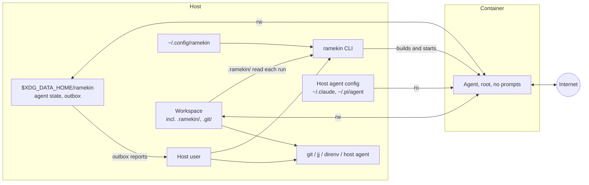

# Threat model

Ramekin runs coding agents with every permission prompt turned off: the base image sets Claude's `permissions.defaultMode` to `bypassPermissions`, and pi has no prompts to begin with. The container and its mounts are therefore the only thing standing between the agent and the host. This document describes what that boundary protects, who attacks it, where it holds, and where it doesn't.

It was last checked against the code at revision `81051a4` (base image: bump node 24 to 26). Revisit it whenever a change touches mounts, config layers, image builds, persistence, or networking.

Out of scope: what model providers do with prompts, multi-user hosts, and network attackers between the host and the internet (TLS is assumed to hold).

## Assumptions

Every status below depends on these. If one breaks, re-read the risks that cite it.

- A1. The host user and host machine are trusted and not already compromised.
- A2. The `ramekin` binary and its release pipeline are trustworthy.
- A3. The container runtime isolates the container. Under Docker that means Linux namespaces with default capabilities and seccomp, inside Docker Desktop's VM on macOS or directly on the host kernel on Linux. Under Apple's `container`, each container is its own VM.
- A4. A read-only bind mount stays read-only. Remounting it writable needs `CAP_SYS_ADMIN`, which Docker's default capability set drops.
- A5. User-layer config (`$XDG_CONFIG_HOME/ramekin/`) and ramekin's state under `$XDG_DATA_HOME/ramekin/` are writable only by the host user, and never mounted into the container except where this document says so.
- A6. **The agent is not trusted.** Anything it reads — repo contents, issues, web pages, dependency source — can carry a prompt injection, so the agent may act for whoever wrote that text. This assumption drives the whole model.

## Assets

- The host filesystem outside the mounts: SSH keys, cloud credentials, browser profiles, other repos.
- Credentials the container can read: the agents' own auth (Claude's OAuth state in `~/.claude`, pi's `auth.json`), passthrough env vars, and credential dirs mounted by profiles (such as `~/.aws`).
- The integrity of the workspace, including its VCS metadata, because host tools later run code and config from it.
- The integrity of host agent config and ramekin config.
- Other repos' agent state: Claude transcripts and pi sessions.

## Actors

- The **hijacked agent**: the agent under an attacker's prompt injection (A6). This is the primary attacker, and it already has a shell inside the container.
- The **repo author**: whoever wrote a repo you run ramekin in, including one you cloned only to inspect.
- The **upstream supplier**: npm, GitHub release assets, and the maintainers behind the tools baked into the base image.
- The **host user**: the protected party. They run ramekin, review its outbox, and work in the same repos with host tools.

## How the pieces connect

The host user runs the `ramekin` CLI, which reads config from three places: the binary, the user's `~/.config/ramekin/`, and the workspace's `.ramekin/`. The CLI builds images, then starts one container per session. The container sees the workspace read-write, host agent config read-only, agent state read-write, and the outbox read-write, and it has unrestricted network access.

The edges that matter most are the loops back to the host. The agent writes to the workspace, and the host later reads that workspace in two ways: ramekin reads `.ramekin/` on the next run, and host tools such as git, jj, direnv, and a host-side agent run config from it. The outbox is a second loop, ending at the host user and whatever agent they hand reports to.

## Risks

The following table summarizes each risk and its status. Statuses mean:

| Status | Meaning |
|---|---|
| Prevented by design | The attack cannot happen. |
| Mitigated | The attack fails unless an assumption breaks. |
| Addressable | Mitigation is possible but not yet done. |
| Open | Accepted; the attack succeeds. |

| ID | Risk | Status |
|---|---|---|
| R1 | A repo's project config grants itself host access | Addressable |
| R2 | The agent rewrites the project config for its next session | Addressable |
| R3 | The agent plants config that host tools execute | Open |
| R4 | The agent exfiltrates credentials over the network | Addressable |
| R5 | One repo's Claude session contaminates every other repo's | Addressable |
| R6 | Outbox reports carry attacks to the host | Addressable |
| R7 | Root-owned setuid files escape onto Linux hosts | Addressable |
| R8 | Masks don't hold against the project layer or image builds | Addressable |
| R9 | A compromised upstream release lands in the base image | Open |
| R10 | The agent escapes the container | Mitigated |
| R11 | The host GitHub token leaks from an image build | Mitigated |
| R12 | The agent tampers with host agent config or forges outbox metadata | Prevented by design |

### R1: A repo's project config grants itself host access

`.ramekin/config.kdl` is the highest-precedence config layer, and the code applies no restrictions to it. A repo author can commit one that mounts any host path, writable, by absolute path or by a relative path that climbs out of the workspace (`../../.ssh`). It can also pass through any host env var, select any profile, mount the Docker socket, and unmask paths the user layer hid. Running `ramekin` in a repo therefore trusts the repo author with the host user's home directory. Combined with R4, that's full credential theft from one `ramekin` invocation in a cloned repo.

Mitigation would be a trust gate like direnv's `allow`: record a hash of each approved project config under `$XDG_DATA_HOME/ramekin/` and refuse to run when the file is new or changed. A narrower option is to limit the project layer to workspace-relative mounts and literal env values.

### R2: The agent rewrites the project config for its next session

The workspace is writable, `.ramekin/` lives in it, and ramekin reads `.ramekin/config.kdl` and `.ramekin/Dockerfile` from the host on every run. A hijacked agent can add `mounts { "~" writable=#true }` and wait: the next session, in any agent, starts with the home directory mounted. This turns a contained compromise into a host compromise one restart later, and the host user never sees a prompt.

A read-only bind of `<workspace>/.ramekin` over itself closes the loop cheaply. The R1 trust gate also catches it, because the rewritten file no longer matches its approved hash.

### R3: The agent plants config that host tools execute

Anything in the workspace that a host tool executes is a path out of the container. Examples include `.git/config` (`core.fsmonitor`, `core.hooksPath`), `.git/hooks/`, `.jj/repo/config.toml`, `.envrc`, `.claude/settings.json` hooks for a host-side Claude, `justfile` recipes, and build scripts like `build.rs`. The host user triggers them by running everyday commands in the repo.

This is inherent to a writable workspace: the agent's job is to change code the host will run. Read-only overlays on `.git/hooks` and `.git/config` would narrow the surface at the cost of some VCS operations inside the container, but reviewing what the agent changed before running it on the host remains the real control. Status: Open.

### R4: The agent exfiltrates credentials over the network

The container has unrestricted egress, so anything the agent can read can leave. That includes the agents' own auth tokens, every passthrough env var, mounted credential dirs, and the workspace itself. The planned firewall sidecar would narrow this, but not close it: an allowlist that includes the model provider's API or GitHub still offers channels to send data through, such as gists or a second account's API key.

### R5: One repo's Claude session contaminates every other repo's

Claude's state persists by default. `~/.claude` and `~/.claude.json` mount read-write from `$XDG_DATA_HOME/ramekin/agents/` and are shared by every repo; only the allowlisted host config entries (`CLAUDE.md`, `settings.json`, `skills/`, `agents/`, `commands/`, `hooks/`) sit on top read-only. A hijacked session in one repo can read every other repo's transcripts under `~/.claude/projects/`. It can also add a user-scope `mcpServers` entry to `~/.claude.json`, which launches a command in every later Claude session in every repo.

Pi is better isolated, because its sessions are per repo, but its global `auth.json` and `models-store.json` are writable from every session.

The shared state is deliberate: auth and onboarding must survive switching repos. Splitting `projects/` per repo would close the transcript leak. Closing the MCP vector needs either a per-repo `~/.claude.json` or a check at session start that flags new `mcpServers` entries.

### R6: Outbox reports carry attacks to the host

The outbox exists so the host user can hand reports to an agent on the host, which has no container around it. A report is agent-authored text, so it can carry a prompt injection aimed at that host agent. The format's rule — describe the problem, don't write a fix — is a convention the agent follows, not something ramekin enforces.

Two narrower problems are fixable in code. `ramekin outbox show` follows symlinks: `collect_files` classifies entries without following links, but `read_to_string` follows them, so a report that's a symlink to `~/.ssh/id_ed25519` prints the host file. `outbox list` and `outbox show` also print file names and bodies raw, so terminal escape sequences reach the host terminal. Refusing anything that isn't a regular file (via `symlink_metadata`) and stripping control characters before printing would fix both. The teardown log of discarded pi writes prints agent-chosen file names too.

### R7: Root-owned setuid files escape onto Linux hosts

The agent runs as root. Under rootful Docker on Linux, files it creates in the workspace or any writable mount are owned by root on the host, and bind mounts don't add `nosuid`. If the agent leaves a setuid-root binary in the workspace and the host user runs it, it runs as root on the host. Docker Desktop on macOS and Apple's runtime map file ownership to the host user, which should defeat this; that hasn't been tested. The Linux behavior is also reasoned from how bind mounts work rather than reproduced.

Running the container as the host user's UID (compose's `user:`), rootless Docker, or user-namespace remapping would close it.

### R8: Masks don't hold against the project layer or image builds

A `/dev/null` mask in the user layer hides a path such as `.envrc` from the agent, but nothing makes that mask stick. The project layer can mount the path back, which the README documents as a feature, so masks only hold as long as R1 and R2 do. Separately, a project image builds with the whole workspace as its context, and masks don't apply to build contexts. A `.ramekin/Dockerfile` can `COPY .envrc` into the image, written by either the repo author or a hijacked agent through R2.

Either masks become a security control, which means user-layer masks that can't be overridden and that also apply to the build context through a generated `.dockerignore`, or the README should state that they are a convenience.

### R9: A compromised upstream release lands in the base image

The base image downloads `difftastic`, `dotslash`, `ranger`, `zizmor`, and `jj` at their latest release with no checksum or signature check. It installs pi and Claude Code from npm without pinning versions, and builds git from the newest tag. A compromised release reaches every image built after it, and that tool then runs with the agent's access, credentials included (R4). Tracking the latest versions is deliberate. Status: Open.

### R10: The agent escapes the container

The agent runs as root, but with Docker's default capabilities and seccomp profile, no Docker socket mounted by session assembly, and no privileged flags. Under Docker Desktop and Apple's runtime, an escape lands in a VM and still has to cross into macOS; on Linux, Docker shares the host kernel, so an escape reaches the host directly. Mitigated, resting on A3. A project or user config that mounts the Docker socket gives this away, and R1 makes that possible for a repo author.

### R11: The host GitHub token leaks from an image build

Base image builds forward a host GitHub token (`RAMEKIN_GH_TOKEN`, `GITHUB_TOKEN`, `GH_TOKEN`, or `gh auth token`) as a BuildKit secret, mounted only in the two `RUN` steps that query release metadata. Secrets don't persist into image layers, and project image builds get no token at all (`github_token: None` in `src/main.rs`). Nothing those steps download gets executed while the secret is mounted: the API response only fills a quoted URL, and the tarballs are extracted, not run. Mitigated, resting on BuildKit's secret handling. The `gh auth token` fallback is also broader than needed: rate-limited metadata reads don't need a token with the user's full scopes.

### R12: The agent tampers with host agent config or forges outbox metadata

Host agent config mounts read-only (A4), session mounts (workspace, agent state, prompt, outbox) are forced and can't be overridden by config, and each outbox's `.agent` sidecar sits next to the mounted directory rather than inside it. The agent can't edit its own instructions, swap its prompt, or misattribute a report.

## Accepted risks

The following risks are accepted outright:

- The agent can delete or corrupt anything it can write: the workspace, writable mounts, caches, and agent state. Version control and backups are the recovery path.
- Sessions have no CPU, memory, or disk limits, so a runaway agent can exhaust host resources.
- Everything in the agent's context goes to the model provider.
- Workspace contents can leave over the network until R4's firewall exists, and partially after.

---

_Drafted with Claude Code (Claude Opus 5.5)._
